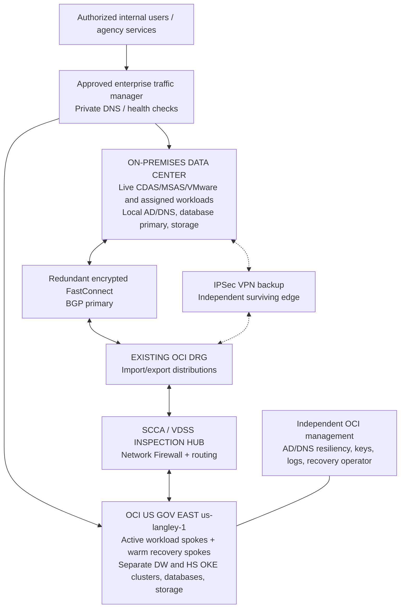

# OCI Government Cloud Hybrid DR: Active Operations with Warm Recovery

**Status:** Proposed design / discovery baseline  
**Version:** 1.0, 2026-10-26  
**Target:** OCI US Government East (Ashburn), `us-langley-1`, OC2  
**Landing zone:** Existing EBLZ / SCCA / CD3 implementation  
**Repository:** `oci-appdev/scca`

> **Design interpretation:** Both on-premises and OCI operate live workloads in steady state. Each site provides reduced-capacity **warm recovery** for workloads whose authoritative production instance runs at the other site. This is **site-level active-active / workload-level active-passive**, not a claim that every application supports two simultaneous database writers. True per-application active-active requires vendor-certified multi-writer support, conflict resolution, and independent quorum/fencing.

## Executive decision

Approve a phased, controlled hybrid DR pilot on the existing network and SCCA landing zone, provided the following gates are passed:

1. Workload owners approve the placement and RPO/RTO of every application and its data stores.
2. Enterprise architecture approves the split-site operating model, one-writer-per-data-set policy and fencing mechanism.
3. The on-premises network and OCI operations teams verify resilient encrypted FastConnect and independently operable VPN/user access paths.
4. Security authorizes data classification, Rule 6(e) handling where applicable, ATO boundaries, DR account roles, backup retention, test data and evidence.
5. Procurement and platform teams validate OC2 shape availability, OCI government contract rates, third-party replication licensing and reserve capacity.
6. A rehearsed failover **and failback** meets measured, not theoretical, RPO and RTO.

## 1. Logical architecture



Physical and logical separation:

- Keep existing FastConnect private peering and upgraded DRG. **Do not create a second DRG** or bypass the VDSS firewall with more-specific routes.
- Attach CD3-managed workload and recovery VCNs to the existing DRG through the approved hub-and-spoke pattern. Baseline and import current DRG/VCN state into Terraform/CD3 before making changes.
- Isolate prod, non-prod, recovery, management, identity, and security logging by compartment, subnet, NSG, security rules and policies.
- Do not assume that OCI public DNS zones or OCI Traffic Management are available in OC2. Use an approved enterprise/private traffic management mechanism with off-site survivability; test application endpoint resolution after the loss of the on-premises DNS servers.
- Avoid public VM/OKE worker IPs. Object Storage, Vault, OCIR and other approved services use private paths such as the service gateway, where supported.
- A single Ashburn region has one availability domain. Use fault-domain distribution where practical for intra-region faults, but **this is not region-level disaster protection**.

### Bidirectional recovery ownership

| Recovery direction | Normal operation | Disaster recovery operation |
| --- | --- | --- |
| On-premises-owned service → OCI | Authoritative write/master and production users on-prem; application/data synchronized toward OCI | Fence on-prem writer; promote data in OCI; scale warm OCI pool; redirect approved private endpoints |
| OCI-owned service → on-premises | Authoritative write/master and production users in OCI; application/data synchronized toward on-prem | Fence OCI writer; recover data/service on-prem; redirect users over independently surviving path |
| Truly multi-site stateless tier | Both sites may serve requests with controlled load sharing | Health checks remove failed site; data tier remains single-writer unless vendor certifies multi-writer |

**Two-site split-brain control:** automatic multi-master failover with only two sites is not assumed safe. Use a supported third-site witness/quorum, or explicit operator fencing and controlled promotion; prove duplicate-write prevention during partial network partitions.

## 2. Workload inventory and recovery pattern

All entries below require validation against the live CMDB, the old/new landing-zone inventory and application owner sign-off. Earlier project material captured **16 DataWalk plus 4 Hyperscience servers**, but this does not exhaust CDAS, MSAS or shared-services inventory.

| Workload/group | Initial approach | Critical dependencies | Open validation |
| --- | --- | --- | --- |
| CDAS | Live placement per mission owner; warm alternate site | Databases, identity, licensing, NFS/object/files, ingress | Inventory, application consistency, vendor DR |
| MSAS | Live placement per mission owner; warm alternate site | GPU/CPU, storage, network, identity | Capacity and data sensitivity |
| DataWalk Dev/Test/Prod | Separate OKE per policy and environment; warm cross-site recovery | Persistent datasets, charts/config, private OCIR mirrors, ingress/certs | Vendor support, K8s version, backup/restore |
| Hyperscience Test/Prod | Separate OKE recovery cluster from DataWalk | CPU platform, A10.2 GPU workers where required, database/object/file storage | GPU capacity in OC2, model/data consistency |
| RHEL / VMware fleet | Tool-assisted OS/VM replication or tested backup/redeploy | Kernel/drivers, DHCP/eth0, images, disks, application order | Recovery-agent fit, licensing, validation |
| Oracle Databases | Hybrid Data Guard where version/licensing/architecture permits | Redo bandwidth, TDE, listener security, standby capacity | Edition/options, SQL version, storage/redo rate |
| Non-Oracle databases | Native replication or application-consistent backup | Replication/failover semantics, write fencing | Vendor-specific implementation |
| AD / ADFS / DNS / NTP | Independent and authenticated recovery-side service | Time source, certificates, YubiKey/admin access, reachable DCs | Offline login, trust/health, authoritative DNS |
| VDMS / VDSS / logging | HA inspection, security evidence and monitoring | Firewall route symmetry, logging retention, key access | Security team approval and independent visibility |
| Jumpboxes / shared services | Independent site administration and secured management | PAM, SSH/RDP, PKI, secrets, monitoring | Break-glass drills |
| Sandbox / Dev / noncritical | Backup/restore; low recovery priority | Repositories, container images, IaC state | Data classification and restore test |

**DataWalk and Hyperscience must not share an OKE cluster or critical recovery storage.** An OCI Kubernetes POC is not evidence of production DR readiness or an ATO. RHEL 8.10, GPU A10.2 shape limits, two separate OKE clusters and related application requirements must be validated in `us-langley-1`.

## 3. Objectives to be approved

Provisional targets only. RPO measures tolerable data loss; RTO measures time from declared incident to verified application service. Requirements must come from mission owners, and testing must validate each target.

| Tier | Services | Proposed RPO | Proposed RTO | Strategy |
| --- | --- | --- | --- | --- |
| 0 | Access/identity, DNS, inspection, keys, critical database control | ≤5–15 min for mutable service state; configuration protected at every approved change | ≤1 hr | Warm live dependencies, rehearsed promotion and independent access |
| 1 | Mission-critical CDAS/MSAS and production transactional databases | ≤15 min | ≤2 hr | Continuous DB/data replication + warm application pools |
| 2 | DataWalk and Hyperscience production workflows | ≤1 hr | ≤4 hr | Warm OKE, recover persistent data/models, activate suitable GPU nodes |
| 3 | Test/dev/sandbox and lower-priority utilities | ≤24 hr | ≤24–48 hr | Backup/restore and IaC rebuild |

RPO near zero requires product-supported data replication, suitable WAN latency/bandwidth and potentially additional database licensing. GPU-driven recovery time can be materially longer when capacity is unavailable or images/models must be restored.

## 4. Network and security design

### Routing requirements

1. Record all authorized on-prem CIDRs (including relevant legacy 172.16 ranges) and OCI 10.x ranges; resolve overlapping networks **before** DR. The old-landing-zone 172.16 cleanup must not silently remove surviving production dependencies.
2. Export existing DRG route tables, route distributions, attachment mapping, FastConnect BGP advertisements, VCN route tables and NSGs into a controlled baseline. CD3/Terraform plan must show no unexpected changes.
3. Prefer redundant FastConnect routes and BGP with an IPSec VPN alternate path; ensure both directions return through the intended inspection path.
4. Require encryption-in-transit per security policy. Private FastConnect does **not** automatically mean encrypted; verify supported IPSec-over-FastConnect or MACsec, approved algorithms and fail-closed behavior.
5. Place security/firewall/identity services on independent power, network and management dependencies, including a way to access OCI when the source data center's entire edge fails.
6. Provide one network flow matrix with source/destination subnet, port, direction, inspection point, owner, purpose, protocol, encryption and test result. Never use unrestricted corporate-to-workload access.

### Required network tests

- Fiber/circuit/BGP loss, CPE failover, VPN takeover, asymmetric routing check, VDSS firewall policy check and latency/throughput measurement.
- Private AD/DNS/Kerberos or LDAPS, Oracle replication, container image pulls from private registry, storage backups, time synchronization, telemetry and SSH from approved jumpbox only.
- Application access without source data center DNS, ADFS, NTP or primary jump host.

### Government controls

- Treat FedRAMP High / DISA IL4 cloud authorization as **infrastructure scope**, not automatic system ATO or approval for every Rule 6(e) dataset.
- Enforce classification, data-residency and contract rules; key custody, RHEL/Oracle license entitlements and encryption approval.
- Least-privilege identity-domain groups, MFA/YubiKey, resource principals/dynamic groups where appropriate, private subnets, immutable/protected backups and approved object retention.
- Separation of production and DR operator roles, audit evidence, retention lock where authorized, alarms for replication lag, unexpected promotion and backup failures.
- Confirm every specific OCI/third-party service is actually offered in OC2 and available at the required limits/quota.

## 5. Data replication design

| Data type | Proposed replication | Consistency rule | Monitoring |
| --- | --- | --- | --- |
| Oracle transaction databases | Data Guard / Active Data Guard only when applicable and licensed | Standby read/apply state; controlled primary promotion | Redo transport/apply lag, archive continuity |
| Other databases | DB-native physical/logical replica or snapshot strategy | Single writer, consistent failover bookmark | Commit/replay lag, consistency validation |
| VMware/RHEL images | Validated replication platform or backup/restore | App-consistent quiesce, boot readiness, safe isolated test | Last successful recovery point |
| OKE apps | IaC/Helm/Git + private images + persistent-data restores | Kubernetes state is rebuildable; persistent state is authoritative | Backup schedule, restore drill |
| Objects/files | Replicate approved immutable objects and app-consistent filesets | Versioning/retention does not replace recoverability | Checksum/object counts, recovery test |
| Config/keys/certs | Controlled IaC/config store, secure independent escrow | No secret material in Git; key and cert access at DR | Reconcile versions/expiration |

Oracle OCI Full Stack DR is an OCI-to-OCI orchestrator; it does not by itself perform cross-platform on-premises-to-OCI workload replication. The hybrid environment requires runbook/workflow orchestration plus workload-specific replication.

## 6. Planned failover procedure (on-prem → OCI)

**Authority:** Incident Commander declares DR. Database owner controls primary promotion. Security validates boundary and emergency access.

1. **Detect and declare:** identify site/application fault, start incident clock, assess split-brain or suspected compromise, and choose disaster recovery versus degraded local service.
2. **Fence old writers:** block/disable failed source write endpoints and terminate unsafe replication, or prove old source cannot resume writes.
3. **Verify restore point:** inspect latest valid database redo, image snapshot, object versions and backups; select recovery point consistent across dependent services.
4. **Promote data tier:** fail over Oracle Data Guard/other DB as prescribed; verify read/write behavior, TDE keys and referential integrity.
5. **Scale application layer:** start/scale warm VM and OKE nodes, attach required disks, mount private storage, load approved images and models, rotate/reload secrets if needed.
6. **Switch traffic:** activate approved enterprise/private DNS/GTM, firewall and route changes. Track TTL and client caching.
7. **Validate service:** synthetic login, CDAS/MSAS workflows, DW queries, HS processing/GPU test, interface checks, security logging and performance.
8. **Communicate:** timestamp declaration, cutover and validation; record achieved RPO/RTO, variances and data reconciliation evidence.

### Reverse direction (OCI → on-prem)

Follow the same declaration/fencing/restore sequence, using on-premises warm recovery pools and independent access. OCI-hosted source services must not be the sole identity, DNS, logging or automation dependency for the on-premises recovery action.

### Failback (either direction)

1. Repair and revalidate original site, connectivity, controls and capacity.
2. Keep the recovered site authoritative; configure **reverse replication** from current production to repaired site.
3. Verify synchronization, consistency and failback rehearsals without enabling dual writers.
4. Schedule approved maintenance and stakeholder notice; quiesce writers, perform planned switchover, change endpoints and revalidate.
5. Reinstate standby, alerts, backups and cost-optimized warm capacity. Preserve audit trail and update runbooks.

Never fail back by powering on an old primary while a promoted copy is still writable.

## 7. Editable cost model

Companion file: `docs/OCI_HYBRID_DR_COST_MODEL.xlsx`.

The workbook intentionally leaves unknown sizes and government contract prices **blank** rather than silently treating missing estimates as zero. Enter current OC2 rate-card values and approved quantities; only then does it produce the all-in monthly recurring cost, annual recurring cost and first-year cost.

Core formula for a line item:

```text
Monthly cost = Quantity × Billable units per month × Net government rate ($ per unit)
Annual recurring = 12 × Sum(monthly recurring lines)
First-year = Annual recurring + One-time setup
```

Required estimate inputs:

| Group | Key inputs and cost treatment |
| --- | --- |
| Active OCI compute | Active workload OCPU-hours, GiB-hours, GPU VM hours and any cluster management charge |
| Warm OCI compute | Always-on reduced pools, test/drill scale-up hours, reserved GPU capacity where supported |
| Storage | Block/boot GB-month, file/object/archive GB-month, immutable backups, snapshot retention |
| Network/security | FastConnect virtual circuits, carrier/cross-connect, VPN, inspection firewall fixed and per-GB charges, load balancing, monitoring/logging |
| Software | Replication agents, DB options/BYOL, RHEL support/subscription, vendor recovery entitlements |
| On-prem DR | Spare capacity, hardware support, backup storage, secondary edge, cooling/power delta if incremental |
| Implementation | IaC/network engineering, data seed, app rebuild, DR testing and training hours |

Be explicit about **incremental program cost vs total hybrid production run rate**. Existing on-premises operating costs are not automatically incremental DR costs. Include data-transfer/seed costs and peak disaster operations in sensitivity planning separately from normal monthly warm-standby spend. Do not assume available GPU quota based only on a POC.

## 8. Implementation plan and stage gates

| Phase / timing | Work | Exit evidence |
| --- | --- | --- |
| 0. Discovery (weeks 1–2) | CMDB, application/data dependencies, ownership, class boundaries, 20 known DW/HS servers reconciliation, tiers | Inventory signed by app, network, security |
| 1. Architecture (weeks 3–4) | DRG/VDSS routing, FC/VPN, DNS/identity continuity, data design, split-brain policy, target rates | Architecture/security review and zero-diff CD3 baseline |
| 2. Foundations (weeks 5–6) | Recovery compartments/VCNs, private service access, alarms, vault/retention, IaC | Network/security test and traceable cost resources |
| 3. Pilot replication (weeks 7–9) | One representative VM, one database, one OKE application with state, reverse replication design | Restore points and end-to-end application tests |
| 4. Recovery drills (weeks 10–11) | Source outage, circuit loss, identity loss, full-site cutover, failback | Achieved RPO/RTO, data integrity, rollback proof |
| 5. Expand (weeks 12–16+) | CDAS, MSAS, DW, HS, shared services per approved sequencing | ATO/change-control approvals and owner sign-offs |

This is a prospective 16-week program, not a claim that any phase is already deployed. Existing 2026-11-25 DW/HS POC validation work should be managed as a related but distinct gate.

## 9. Risks and decisions

| Priority | Risk / decision | Mitigation or requested decision |
| --- | --- | --- |
| Critical | “Active-active + warm standby” misunderstood as simultaneous writes to all data | Approve site-level active-active and one writer per data store, except certified multi-master |
| Critical | On-premises outage removes authentication, DNS and network edge required to reach OCI | Run independent failover access drill and cross-site identity plan |
| Critical | Two sites cause split-brain in network partition | Fencing/witness design and failover authority |
| High | Ashburn region and a local on-prem site share regional hazard | Verify geography and accept single-cloud-region risk or expand scope later |
| High | Existing 172.16 legacy resources overlap/route unexpectedly | Reconcile CIDRs and old/new landing-zone mapping |
| High | GPU shapes or quotas not available on demand in OC2 | Reserve/validate capacity; define degraded-mode services |
| High | Vendor stateful workloads cannot restore in targeted RTO | Application-specific POC, vendor certification and timed drills |
| High | Cloud or backup data violates scope/ATO requirements | Security/mission data-approval gate prior to replication |
| High | RHEL, Oracle DB or third-party DR license costs omitted | Validate contracts, not commercial list rates |

## 10. Acceptance criteria

- All production workloads, ownership, dependencies, protection and recovery direction are documented.
- Both on-prem → OCI and OCI → on-prem failover drills are successfully completed for representative critical workloads.
- Demonstrated recovery of database, application, DNS, auth, private network access and logging with source site unavailable.
- No split-brain or unintended direct route around VDSS; non-overlapping CIDRs and verified encrypted transport.
- Recovery outcomes are documented against signed RPO/RTO; backup recovery points and retention are independently verified.
- Cost model uses approved rates, confirmed quantities and disaster-state scale-up assumptions, with a signed operational budget.
- Fallback/failback works; approvals, runbooks and change evidence are archived.

## Official references

- [Oracle US Government Cloud: regions and service limitations](https://docs.oracle.com/en-us/iaas/Content/gov-cloud/govfedramp.htm)
- [FastConnect redundancy best practices](https://docs.oracle.com/en-us/iaas/Content/Network/Concepts/fastconnectresiliency.htm)
- [FastConnect security: IPSec and MACsec](https://docs.oracle.com/en-us/iaas/Content/Network/Concepts/fastconnectsecurity.htm)
- [OCI on-premises routing and redundancy](https://docs.oracle.com/en-us/iaas/Content/Network/Concepts/routingonprem2.htm)
- [Hybrid Data Guard for on-premises and OCI](https://docs.oracle.com/en/database/oracle/oracle-database/19/haovw/oracle-data-guard-hybrid-cloud-configuration1.html)
- [Oracle on-premises DB with standby OCI reference architecture](https://docs.oracle.com/en/solutions/standby-database-in-cloud/index.html)
- [Full Stack DR OCI-to-OCI boundary](https://docs.oracle.com/en/solutions/oci-best-practices/plan-your-disaster-recovery-strategy.html)
- [Oracle OCI cloud cost estimator](https://docs.oracle.com/en-us/iaas/Content/Billing/Tasks/signingup_topic-Estimating_Costs.htm)

**Security note:** This design contains conceptual infrastructure only. No actual CIDRs, OCIDs, credentials, keys, Rule 6(e) information or internal diagrams containing sensitive details are embedded in this public repository document.
